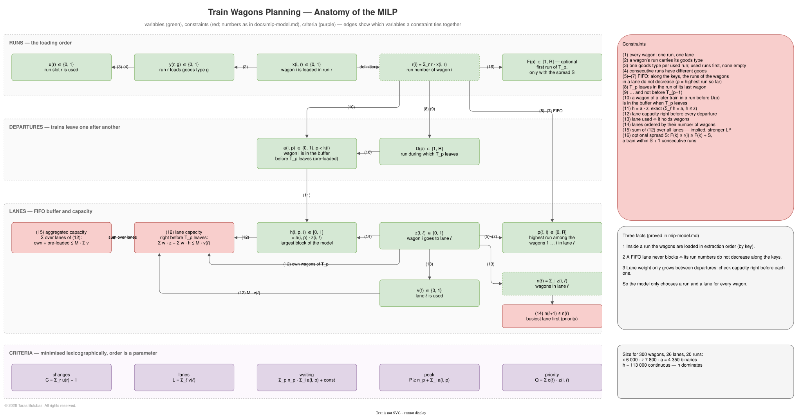
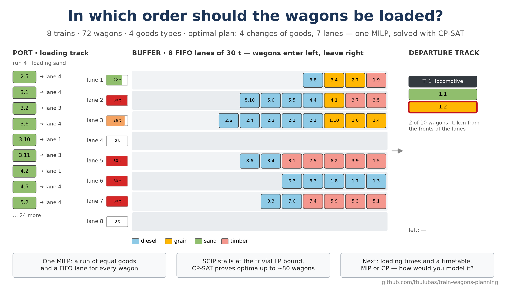

# Train Wagons Planning

Wagons are loaded one by one in a port and moved into a buffer of N FIFO
lanes with a load capacity M each; from there the trains of a given dispatch
plan are assembled, one after another. The task is to find the loading order
and the lanes so that every train can be assembled without the yard ever
getting stuck, with as few changes of goods during loading as possible, then
as few lanes and as few wagons waiting in the buffer as possible, preferring
the lanes closest to the exit.

The problem is solved as a single mixed-integer linear model (MILP) with
SCIP or CP-SAT; the project explores how large the instances can get before
the solvers stop proving optimality.

- Problem statement: [docs/problem-statement.md](docs/problem-statement.md)
- Mathematical model: [docs/mip-model.md](docs/mip-model.md), with diagrams in
  [docs/model-overview.md](docs/model-overview.md) (draw.io)
- Benchmark — how far the MILP goes: [docs/benchmark.md](docs/benchmark.md)



## Author

**Taras Bulubas** — taras.bulubas@gmail.com

All work on this project was done on my own hardware and in my private time.
All new and original ideas in it — the problem, the modelling approach and
its formulation — are my own and the result of many years of work in
optimisation, operations research and algorithms.

**Use of AI.** Claude (an AI assistant by Anthropic) was used to help write
the code and the documentation, following my specifications and decisions.

**License.** © 2026 Taras Bulubas. All rights reserved. This repository is
published for viewing only; any use requires my prior written permission —
see [License](#license).

## Development environment

Requires Python 3.12 and GNU make 3.82+. The solvers, SCIP and CP-SAT, are
shipped with OR-Tools, so nothing else has to be installed.

All dependencies are declared in [pyproject.toml](pyproject.toml):

| Group       | Packages  | Used for                |
|-------------|-----------|-------------------------|
| runtime     | `ortools` | the MILP, SCIP, CP-SAT  |
| extra `dev` | `pytest`  | tests                   |
| extra `plot` | `matplotlib` | the image          |

### Getting make on Windows

make is not part of Windows. Install it once, e.g. with

```bash
winget install ezwinports.make
```

or `choco install make` (from an administrator shell). Open a new terminal
afterwards so that `make` is on the `PATH`.

### Make targets

```bash
make venv
```

creates `.venv` with **Python 3.12** and installs the project in editable
mode with the `dev` and `plot` extras. Running it again only reinstalls when
`pyproject.toml` or the `Makefile` has changed.

The version is pinned in the Makefile (`PYTHON_VERSION := 3.12`). On Windows
the base interpreter is found with the py launcher (`py -3.12`), elsewhere as
`python3.12`, so it does not matter which `python` comes first on the `PATH`.
If `.venv` exists with another Python version, `make venv` stops and asks for
`make recreate`. To move the project to another version, change
`PYTHON_VERSION` and run `make recreate`.

| Target               | What it does                                           |
|----------------------|--------------------------------------------------------|
| `make` / `make help` | list the targets                                       |
| `make venv`          | create `.venv` and install the project with `dev`      |
| `make test`          | run the tests with pytest                              |
| `make run`           | solve an example instance; options with `ARGS="..."`   |
| `make view`          | solve the example and open the plan viewer `out/plan.html` |
| `make image`         | render `images/train-wagons-linkedin.png`              |
| `make benchmark`     | solve the benchmark grid (hours) and write `docs/benchmark.md` |
| `make report`        | write `docs/benchmark.md` from `docs/benchmark/*.csv`  |
| `make diagrams`      | export `docs/diagrams/*.drawio` to SVG (draw.io desktop app) |
| `make clean`         | remove caches and build metadata                       |
| `make distclean`     | `clean` and remove `.venv`                             |
| `make recreate`      | `distclean`, then `venv` — a fresh environment         |

`test` and `run` create the environment first if it does not exist. The
Makefile works from PowerShell, cmd and Git Bash on Windows as well as on
Linux/macOS.

### Without make

```bash
py -3.12 -m venv .venv
.venv/Scripts/python -m pip install -e ".[dev,plot]"
```

(On Linux/macOS use `python3.12 -m venv .venv` and `.venv/bin/python`.)

### IntelliJ IDEA

See [docs/intellij.md](docs/intellij.md): register `.venv` as the project
interpreter and use the shared run configurations in `.run/` to run the
tests and the application.

## Usage

```bash
make run
```

which runs `python -m train_wagons --trains 4 --seed 1` in `.venv`: it
generates a random dispatch plan, solves the MILP with CP-SAT criterion by
criterion, checks the plan with `simulate` and prints the loading order, one
line per block of goods, with the moments the trains leave.

Instance options: `-K/--trains`, `--min-wagons`/`--max-wagons` per train,
`-G/--goods` number of goods types, `--heavy-share` share of heavy wagons
(4–14 t; the others carry 0.2–1 t), `-N/--lanes`, `-M/--capacity` load
capacity of a lane in tonnes, `--seed`.

Planning options: `--objective`, the criteria in priority order from
`changes`, `lanes`, `waiting`, `peak`, `priority` (default
`changes,lanes,waiting,priority`); `--solver` `cp-sat` (default), `scip`,
`baseline` for the reference plan (train by train, grouped by goods within
each train) or `waves` for the heuristic plan in waves; `--time-limit`
seconds per criterion (default 30); `-R/--runs` run slots (default: the runs
of the best heuristic plan); `-H/--lookahead`; `-S/--spread`, the largest
number of runs between the first and the last run of a train;
`--max-lanes`; `--symmetry`
`size` (default), `first` or `none`; `--start` from the best heuristic plan —
see [docs/mip-model.md](docs/mip-model.md).

### Plan viewer

```bash
make view
```

solves the example and opens `out/plan.html` in the browser; any run writes
the viewer with `--html FILE`, e.g.
`python -m train_wagons -K 12 --start --html out/plan.html`. The page is
self-contained and replays the plan event by event: on the left the wagon
just loaded in the port and the next ones, in the middle the buffer with its
FIFO lanes (front on the right) and the weight in every lane, on the right
the departure track where each train is assembled from the fronts of the
lanes and leaves. Below, the dispatch plan shows every wagon as not loaded,
in the buffer, on the track or gone. Play, pause and step with the buttons,
the slider or the keys Space, ←, →, Home and End.

From Python:

```python
from train_wagons import YardInstance, simulate
from train_wagons.model import ModelOptions, solve

instance = YardInstance(
    trains=((("grain", 10.0), ("sand", 10.0)), (("sand", 10.0), ("grain", 10.0))),
    lanes=2, capacity=20.0,
)
plan = solve(instance, "changes,lanes,waiting,priority", ModelOptions(solver="cp-sat"))
print(plan.status, plan.loads)
result = simulate(instance, plan)
assert result.errors == []
print(result.metrics, result.departures)
```

`simulate` carries out a plan step by step, lets every train leave as early as
possible and reports violated rules, independently of any model; `verify`
returns only the violations.

## Image



```bash
make image
```

solves an instance of 8 trains and 72 wagons with CP-SAT (one thread, so the
plan and the image are the same on every run, about a minute), checks the
plan with `simulate` and draws the yard while the first train is assembled:
the next wagons in the port, the eight FIFO lanes with their weight, and the
departure track. The script writes `images/train-wagons-linkedin.png`
(2400 × 1350 px).

## Benchmark

```bash
make benchmark
```

runs [scripts/benchmark.py](scripts/benchmark.py): random instances on a
grid of trains K × load factor λ, plus the reference buffer with 26 lanes,
each solved for the changes criterion with CP-SAT and SCIP, with and without
a heuristic start, and every plan checked with `simulate`. Results go to
`docs/benchmark/*.csv` (an interrupted run resumes where it stopped) and the
tables to [docs/benchmark.md](docs/benchmark.md).

While it runs,

```bash
scripts/watch_benchmark.sh
```

(in Git Bash on Windows, or on Linux) shows every 5 s the CPU and memory
load, the running Python processes and, per configuration, how many
instances are done and the last result.

## Tests

```bash
make test
```

Besides the checks of `simulate`, the tests compare the optimum of the MILP,
with both solvers and for several objectives, with an exhaustive search over
all loading orders and lanes on about 100 tiny random instances
([tests/exhaustive.py](tests/exhaustive.py)), including instances without
any valid plan.

## Layout

```
docs/                 problem statement, mathematical model, diagrams (draw.io), benchmark, IntelliJ setup
src/train_wagons/
  instance.py         dispatch plan, buffer and the random instance generator
  solution.py         LoadingPlan, the step-by-step simulate() and verify()
  baseline.py         reference plan, train by train
  viewer.py           interactive HTML viewer of a plan
  draw.py             yard snapshots of a plan and the image
  heuristic.py        heuristic plan in waves (upper bound, R, start)
  model.py            the MILP, solved lexicographically with SCIP or CP-SAT
  cli.py              command line interface
scripts/              benchmark.py runs the grid, linkedin_image.py renders the image,
                      watch_benchmark.sh shows the progress, check_venv.py guards the Python version
tests/                pytest suite; exhaustive.py searches tiny instances completely
.run/                 shared IntelliJ run configurations
Makefile              environment and task shortcuts
LICENSE               all rights reserved
```

## License

© 2026 Taras Bulubas. **All rights reserved.**

This repository — code, models, documentation and images — is published for
viewing only. Using, running, copying, modifying or distributing any part of
it requires my prior written permission.

See [LICENSE](LICENSE) for the full terms. To ask for permission, write to
taras.bulubas@gmail.com.
