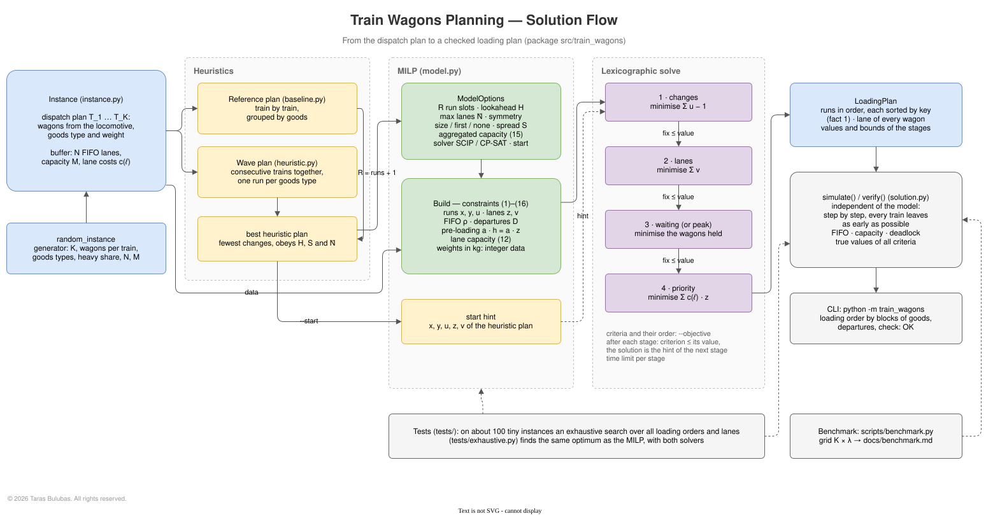
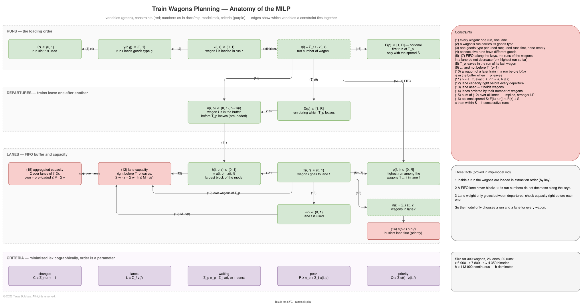

# Model Overview — Diagrams

Two diagrams show how the planning model is built. The sources are plain
draw.io XML files (an `mxGraphModel`, uncompressed) in [`diagrams/`](diagrams/),
so they can be opened and edited in draw.io — the web app
[app.diagrams.net](https://app.diagrams.net), the desktop app or the
*Diagrams.net Integration* plugin of IntelliJ — and imported into Miro
(*Upload → diagrams.net / draw.io*).

The SVG images below are exported from them with the draw.io desktop app:

```bash
make diagrams
```

re-exports every diagram whose `.drawio` file changed (override the path of
the app with `DRAWIO="..."`).

| Diagram | Source | Shows |
|---------|--------|-------|
| [Solution flow](#1--solution-flow) | [`solution-flow.drawio`](diagrams/solution-flow.drawio) | the modules and the path from the dispatch plan to a checked loading plan |
| [Anatomy of the MILP](#2--anatomy-of-the-milp) | [`model-anatomy.drawio`](diagrams/model-anatomy.drawio) | the variables, the constraints that tie them together, and the criteria |

Colours: blue — data and plans, yellow — heuristics, green — variables of the
MILP, red — constraints and departures, purple — criteria, grey — checks.
Constraint numbers refer to [mip-model.md](mip-model.md).

## 1 · Solution flow



The instance (dispatch plan and buffer) goes to two heuristics: the
reference plan loads train by train, the wave plan loads groups of
consecutive trains goods type by goods type. The better of the two fixes the
number of run slots R and can serve as a start. The MILP is built once and
solved lexicographically — changes, lanes, waiting (or peak), priority — each
stage fixing its criterion at the value found and handing its solution to the
next stage as a hint. The resulting loading plan is checked by `simulate`,
which carries it out step by step without any knowledge of the model. The
tests compare the optimum with an exhaustive search on tiny instances; the
benchmark measures how far the MILP goes.

## 2 · Anatomy of the MILP



Three bands, read top to bottom:

- **Runs.** x(i, r) puts each wagon into a run; y and u give every used run
  one goods type, consecutive runs different ones (2)–(4). The run number
  r(i) of a wagon is the only thing the rest of the model needs from x.
- **Departures.** D(p) is the run during which T_p leaves: the run of its
  last wagon, never before T_(p−1) (8)–(9). A wagon of a later train in an
  earlier run is in the buffer when T_p leaves: a(i, p) = 1 (10).
- **Lanes and capacity.** z(i, ℓ) puts each wagon into a lane. Along the
  keys the run numbers in a lane may not decrease (5)–(7), with ρ carrying the
  highest run so far — this is the FIFO rule. h = a · z (11) is the weight of
  the pre-loaded wagons per lane, which together with the own wagons of T_p
  must fit the capacity right before every departure (12); their sum over all
  lanes (15) strengthens the LP. Lanes are ordered by their number of wagons
  (14), which removes symmetry without losing a plan with the best priority.

The criteria at the bottom use only u, v, a and z. The panel on the right
lists all constraints, the three facts that make the model this small, and
its size: the h variables dominate.

---

© 2026 Taras Bulubas. All rights reserved. See [LICENSE](../LICENSE).
